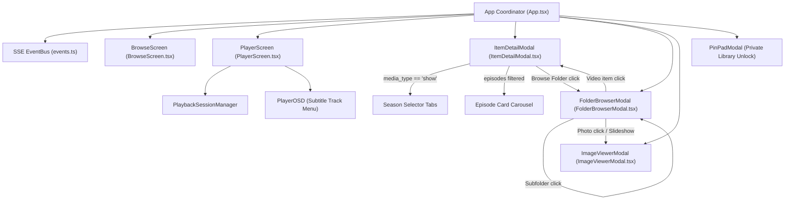

# Kadr v0.1.1-alpha Feature Suite - Design Specification

**Target Platforms:** Samsung Tizen OS (2020+ / Tizen 5.5+ / Chromium 69+), 1080p Canvas (1920×1080), 10-foot TV UI.  
**Server Baseline:** Kadr Media Server v0.1.1-alpha (`docs/CLIENT_GUIDE.md`).  
**Author:** AI Pair Programmer & User  
**Status:** Approved  
**Date:** 2026-10-07  

---

## 1. Executive Summary

This specification defines the implementation of the complete Kadr v0.1.1-alpha feature suite for the Samsung Tizen OS client application. It brings the client into full parity with the server's capabilities and contracts specified in `CLIENT_GUIDE.md`:

1. **TV Show & Multi-Season Series Grouping**: Season tabs selector, episode shelf carousel with per-episode progress bars and resume badges, and 1-click episode playback.
2. **Direct Folder Navigation & Hierarchical Folder Browser**: Direct "Browse Folder" action in Item Details, sandboxed library directory browser with breadcrumbs, subdirectories, media cards, and photo preview tiles.
3. **Photo Lightbox & Slideshow**: Dedicated fullscreen photo viewer with manual D-pad controls and a 4-second auto-advancing slideshow.
4. **Canonical 3-Step Playback Session Protocol**: Adherence to `POST /sessions` $\to$ 10s `POST /:session_id/progress` $\to$ `DELETE /sessions/:session_id`.
5. **Subtitles & In-Player OSD Menu**: Subtitle discovery (`/items/:id/subtitles`), WebVTT streaming (`/subtitles/:id/stream.vtt`), and in-player track switching.
6. **Private Library PIN Protection**: Interception of `403 LIBRARY_LOCKED` responses, on-screen 4-digit PIN unlock dialog, and automatic request retry with `X-Library-Unlock-Token`.
7. **Real-Time Server-Sent Events (SSE)**: Event listener for `layout:changed`, `session:synced`, and `library:updated` to keep the TV client fresh without manual reloads.

---

## 2. Architecture & Component Hierarchy



---

## 3. Detailed Specifications

### 3.1 Data Types & Contracts (`src/types/kadr.ts`)

```typescript
export interface EpisodeCard {
  id: number;
  title: string;
  subtitle?: string;
  season: number;
  episode: number;
  playback_progress?: number; // float 0.0 - 1.0
  badge?: string;
  poster_url?: string;
}

export interface MediaItemDetail {
  id: number | string;
  card: CardViewModel;
  overview?: string;
  genres?: string[];
  duration_seconds?: number;
  stream_url: string;
  resume_position_seconds?: number;
  episodes?: EpisodeCard[] | null;
  library_id?: string;
  folder_path?: string;
  technical?: {
    duration_seconds?: number;
    resolution?: string;
    video_codec?: string;
    audio_codec?: string;
    audio_channels?: number;
    container?: string;
  };
}

export interface PlaybackSession {
  session_id: string;
  media_item_id: number;
  duration_seconds: number;
  resume_position_seconds: number;
}

export interface SubtitleTrack {
  id: number;
  media_item_id: number;
  source: string;
  language: string;
  title: string;
  format: string;
  is_default: boolean;
  is_forced: boolean;
  stream_url: string;
}

export interface FolderBreadcrumb {
  name: string;
  path: string;
}

export interface FolderDirectory {
  name: string;
  path: string;
  item_count: number;
}

export interface FolderImage {
  name: string;
  path: string;
  url: string;
  size_bytes: number;
}

export interface LibraryFolderResponse {
  library_id: string;
  library_name: string;
  current_path: string;
  parent_path?: string;
  breadcrumbs: FolderBreadcrumb[];
  directories: FolderDirectory[];
  items: CardViewModel[];
  images: FolderImage[];
}
```

---

### 3.2 Canonical Playback Session Management (`src/api/playback.ts` & `src/player/session.ts`)

1. **Session Initialization**:
   - Route: `POST /api/v1/playback/sessions`
   - Body: `{ "media_item_id": itemId }`
   - Returns: `session_id`, `resume_position_seconds`, `duration_seconds`.
2. **Heartbeat Loop**:
   - Interval: Every 10 seconds while playing.
   - Route: `POST /api/v1/playback/{session_id}/progress`
   - Body: `{ "position_seconds": Math.floor(currentTime) }`
3. **Session Termination**:
   - Route: `DELETE /api/v1/playback/sessions/{session_id}`
   - Executed on unmount, back navigation, or video completion.
4. **Resilience**:
   - If session creation fails or server is offline, video playback continues smoothly with local state.

---

### 3.3 TV Show Series & Multi-Season Navigation (`src/screens/ItemDetailModal.tsx`)

1. **Season Detection & Grouping**:
   - When `item.card.media_type === 'show'` or `item.episodes && item.episodes.length > 0`:
     - Calculate unique seasons: `const seasons = Array.from(new Set(item.episodes.map(e => e.season))).sort((a,b) => a - b)`.
     - Initial active season: first season containing an episode with `playback_progress < 0.9` or Season 1.
2. **UI Layout**:
   - Primary Action Bar:
     - `Resume (S01E02)` / `Play S01E01`: Primary button targeting the next unwatched episode.
     - `Browse Folder`: Secondary button present when `item.library_id && item.folder_path` are defined.
     - `Back`: Closes modal.
   - Season Tabs Bar:
     - Horizontal pill buttons with IDs `season-tab-${season}` in group `season-tabs`.
     - Selecting a tab filters the displayed episode carousel.
   - Episode Carousel:
     - Horizontal row of `TVCard` elements in group `season-episodes-${activeSeason}`.
     - Card shows `title`, `S01E02` subtitle, progress bar (`progressPercent`), and `badge`.
     - Pressing Enter on an episode triggers `onPlay(episode.id, resumeMs)`.
3. **Spatial Navigation Flow**:
   - Action buttons $\leftrightarrow$ `Down` $\to$ Season tab bar $\leftrightarrow$ `Down` $\to$ Episode cards $\leftrightarrow$ `Up` $\to$ Season tab bar.

---

### 3.4 Hierarchical Folder Browser (`src/screens/FolderBrowserModal.tsx`)

1. **State & Fetching**:
   - Takes `libraryId: string` and optional initial `path?: string`.
   - Calls `fetchLibraryFolders(client, libraryId, currentPath)`.
2. **Layout Sections**:
   - **Header**: Library name and breadcrumbs (`BreadcrumbPill` components).
   - **Directories Row / Grid**: Folder icons with name and count (e.g. `📁 Behind The Scenes (3)`). Clicking navigates deeper.
   - **Media Items Row**: Horizontal `TVCard` shelf for video files. Clicking opens details or plays.
   - **Photo Gallery**: Grid of photo thumbnails with a "Start Slideshow" button.
3. **Navigation & Back Handling**:
   - Hardware Back / Escape:
     - If `currentPath !== ''`: Navigates to `parent_path` or parent breadcrumb.
     - If `currentPath === ''`: Closes the modal.

---

### 3.5 Photo Lightbox & Auto-Advancing Slideshow (`src/screens/ImageViewerModal.tsx`)

1. **Modes**:
   - `manual`: User browses photos via Left / Right D-pad.
   - `slideshow`: 4-second auto-advancing interval with smooth transitions.
2. **Remote Key Handling**:
   - `ArrowLeft` / `ArrowRight`: Navigate photos.
   - `Enter` / `MediaPlayPause`: Toggle slideshow auto-advance.
   - `Back` / `Escape`: Exit viewer and return focus to the photo tile.
   - HUD auto-hides after 3 seconds of inactivity and reappears on keydown.

---

### 3.6 Subtitles & In-Player Track Selection (`src/components/osd/PlayerOSD.tsx`)

1. **API Client Discovery**:
   - Calls `GET /api/v1/items/{itemId}/subtitles` on player launch.
2. **OSD Subtitle Menu**:
   - Adds a Subtitles (`CC`) button in the player OSD.
   - Pressing Enter opens a vertical track picker: `Off`, plus available tracks with language and source.
   - Configures the active subtitle stream (`/api/v1/subtitles/{id}/stream.vtt`) in the player driver.

---

### 3.7 Private Library PIN Protection (`src/api/libraries.ts` & `src/api/client.ts`)

1. **Token Storage**:
   - `ApiClient` tracks `Map<string, string>` for unlocked library tokens.
   - Adds `X-Library-Unlock-Token: <token>` to request headers and `?unlock_token=<token>` to stream URLs.
2. **403 Interception & Modal Flow**:
   - If an API call fails with status `403` and body `LIBRARY_LOCKED`:
     - Triggers `PinPadModal` prompting for the 4-digit library PIN.
     - Calls `POST /api/v1/libraries/{id}/unlock`.
     - On success: stores token and retries the pending action.

---

### 3.8 Real-Time Server-Sent Events Bus (`src/api/events.ts`)

1. **Connection**:
   - Subscribes to `GET /api/v1/events` via `EventSource`.
   - Handles automatic reconnection and pings.
2. **Event Dispatching**:
   - `layout:changed`: Calls `onLayoutChanged(screen_id)` to re-fetch dynamic layouts.
   - `session:synced`: Notifies active continue-watching widgets.
   - `library:updated`: Notifies active folder browser or library catalogs.

---

## 4. Verification & Testing Strategy

1. **Unit & Integration Tests**:
   - `tests/screens/ItemDetailModal.test.tsx`: Test TV show season tabs switching, episode rendering, and 1-click episode playback.
   - `tests/screens/FolderBrowserModal.test.tsx`: Test breadcrumb navigation, subfolder entry, media item selection, and Back handling.
   - `tests/screens/ImageViewerModal.test.tsx`: Test manual photo switching, slideshow auto-advance, and keybindings.
   - `tests/player/session.test.ts`: Test 3-step session lifecycle (start $\to$ heartbeat $\to$ end).
   - `tests/api/subtitles.test.ts` & `tests/player/subtitles.test.tsx`: Test subtitle discovery and in-player track selection.
   - `tests/api/libraries.test.ts`: Test private library PIN unlock and 403 retry.
   - `tests/api/events.test.ts`: Test SSE event processing.
2. **Build & Package Verification**:
   - `npm test`: 100% test pass rate with 0 regressions.
   - `npm run build`: Clean TypeScript compilation targeting Chromium 69+.
   - `npm run package:wgt`: Valid `kadr.wgt` generated for Samsung Smart TVs.
